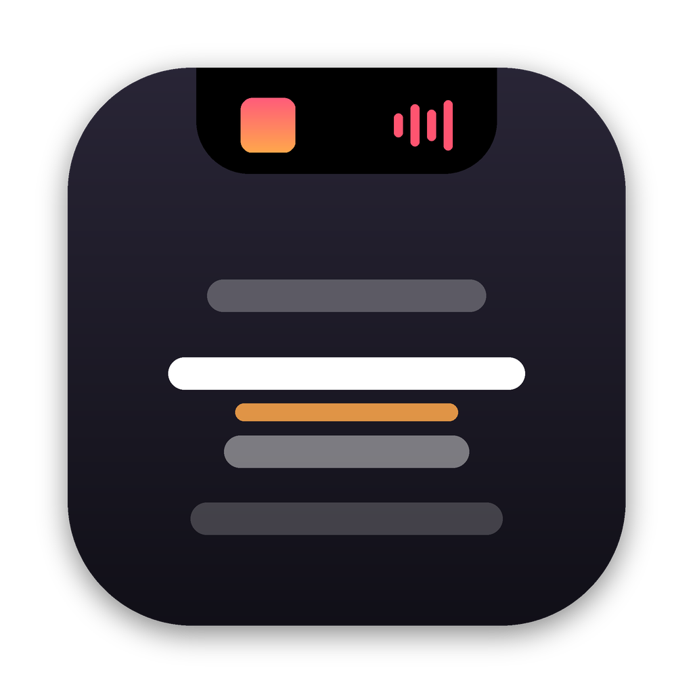
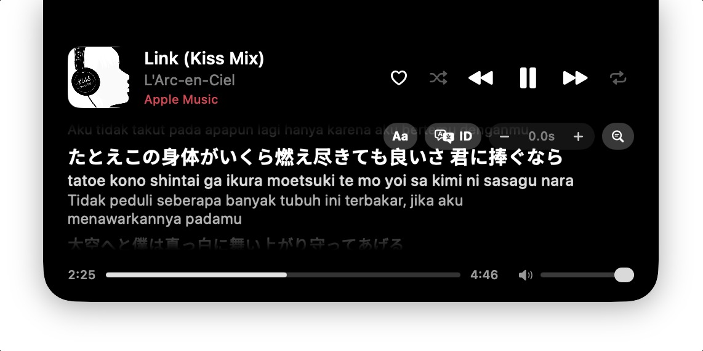

<p align="center">
  
</p>

<h1 align="center">NotchLyrics</h1>

<p align="center">
  Time-synced lyrics in your MacBook's notch, for Spotify and Apple Music.
</p>

<p align="center">
  
</p>

---

## Features

- **Synced lyrics** under the notch, with a full lyrics view on hover
- **Playback controls**: play/pause, skip, seek, volume, shuffle and repeat
- **Romanization** for Japanese, Korean, Chinese and other non-Latin lyrics
- **Translation** of lyrics into 8 languages, on-device (macOS 15+)
- **English and Indonesian** interface
- **Lyrics picker** to choose a different version when a match is wrong
- **Stays out of the way**: click-through lyrics that fade as your cursor approaches
- **Extras**: track-change banner, sleep timer, launch at login, offline cache

## Requirements

- macOS 14 Sonoma or later (translation requires macOS 15)
- A MacBook with a notch (other Macs show a compact pill at the top of the screen)
- Spotify desktop app and/or Apple Music

## Installation

### Download

Grab `NotchLyrics.zip` from the [latest release](https://github.com/rezaprahenda/NotchLyrics/releases/latest),
unzip it and move `NotchLyrics.app` to `/Applications`.

The app is not notarized, so macOS may say it "can't be opened" or "is damaged". Run this once:

```bash
xattr -dr com.apple.quarantine /Applications/NotchLyrics.app
```

### Build from source

Building requires the Xcode Command Line Tools.

```bash
xcode-select --install          # if not installed yet
git clone https://github.com/rezaprahenda/NotchLyrics.git
cd NotchLyrics
./build.sh install              # builds and copies the app to /Applications
```

On first launch, allow NotchLyrics to control Spotify or Music when prompted.
This permission is used only to read the current track and send playback commands.

## Usage

- Play a song. The notch shows the current lyric line.
- Hover over the notch for the full view and controls.
- Use the menu bar icon for settings.

## Privacy

NotchLyrics has no account, analytics or tracking. It sends the track title, artist,
album and duration to [LRCLIB](https://lrclib.net) to fetch lyrics, and to the iTunes
Search API to fetch artwork when needed. Romanization and translation run on-device.

## Acknowledgements

Lyrics are provided by [LRCLIB](https://lrclib.net), a free and open lyrics database.

## License

Released under the [MIT License](LICENSE).

NotchLyrics is an independent project and is not affiliated with Spotify or Apple.
Spotify and Apple Music are trademarks of their respective owners.
